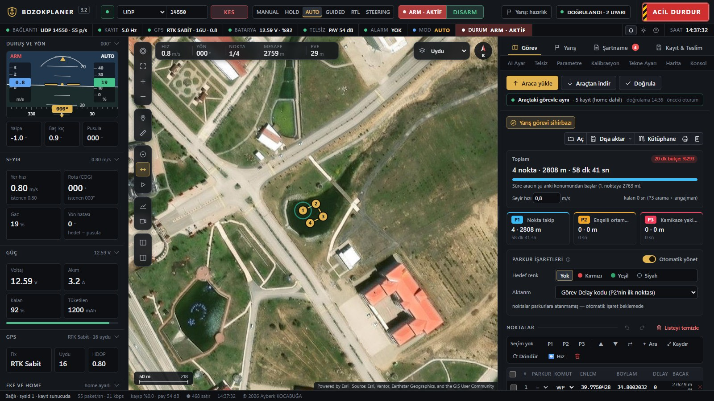
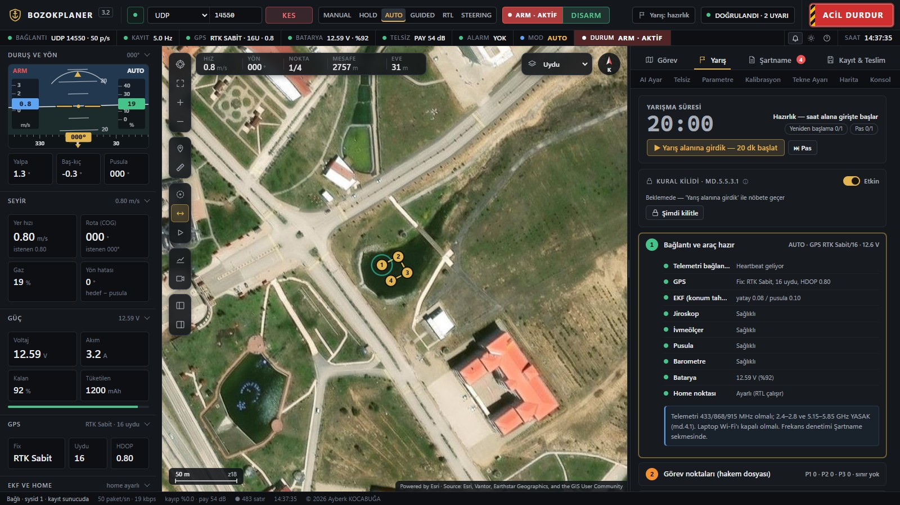
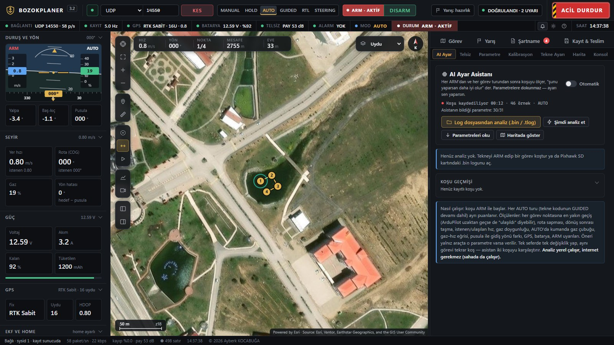

# BozokPlaner

**A web-based mission planner, race assistant and ground control station (GCS)** built for the TEKNOFEST Unmanned
Surface Vehicle (USV) competition, as a purpose-built replacement for Mission Planner.

> This repository is a project showcase. The software is not distributed publicly.

## Highlights

- **Competition-aware mission planner.** Waypoints are assigned to Course 1/2/3 and the planner writes the Delay
  markers (course boundary + target color) exactly the way the boat's onboard software parses them, then removes
  markers that could be misread. Live validation, a 20-minute time budget, undo/redo and a printable mission sheet.
- **Race assistant and rule lock.** A 20-minute race clock, restart/skip rights and a 7-step race-day checklist.
  Once the vehicle starts moving, the link layer itself blocks every outgoing packet except emergency stop, as the
  rules require.
- **Specification-compliant logging.** Required telemetry files are written on the server at 5 Hz on an absolute
  time grid with `fsync`, so a backgrounded browser tab or a pulled plug does not cost data. Raw MAVLink, an
  event log and a submission package with a SHA-256 manifest are produced alongside.
- **AI tuning assistant.** After every ARM and every mission lap it measures the run (closest pass to each waypoint,
  track deviation, overshoot after turns, throttle saturation, compass vs. course-over-ground, drift) and suggests
  parameter changes, but **never writes parameters itself**. It also parses Pixhawk DataFlash `.bin` and `.tlog`
  logs in the browser (a 26 MB `.bin` in about 0.3 s). On a real competition log it reproduced a manual analysis
  and found the root cause of missed waypoints: the RC throttle stick was overriding the AUTO speed.
- **Radio tools.** Reads and writes SiK telemetry modem settings over Web Serial and diagnoses link health from
  packet loss, RSSI and noise.
- **Field resilience.** The vehicle link and logging live on the server, not in the tab: closing the browser does
  not stop them, and after a server crash logging resumes in the same session folder. Audible and visual alarms.
- **Offline maps**, UDP / TCP / serial / Web Serial connections, and `.waypoints`, `.plan`, `.kml`, `.geojson`,
  `.csv` import and export.

| Race assistant | AI tuning assistant |
|---|---|
|  |  |

*Screenshots were taken with the built-in simulated vehicle.*

## Engineering

- **Stack:** Node.js server and plain HTML/CSS/JavaScript. Apart from `serialport`, there are **no npm
  dependencies**: the WebSocket server, MAVLink parser, map engine, HUD, charts and the MP4 reader used for
  submission checks are all written from scratch.
- **MAVLink tables** are generated from the pymavlink dialect definitions.
- **Desktop launcher:** a small C# tray application starts the server under a watchdog, opens the UI in a
  Chrome/Edge app window and keeps logging alive when the window is closed.
- **Testing:** 406 automated unit and end-to-end tests, including killing the real server process mid-session
  and verifying that logging resumes. A simulated Pixhawk can inject faults (throttle ceiling, compass offset,
  stick override, radio interference) to exercise the tuning assistant.

## Author

© 2026 Ayberk KOCABUĞA. All rights reserved.
